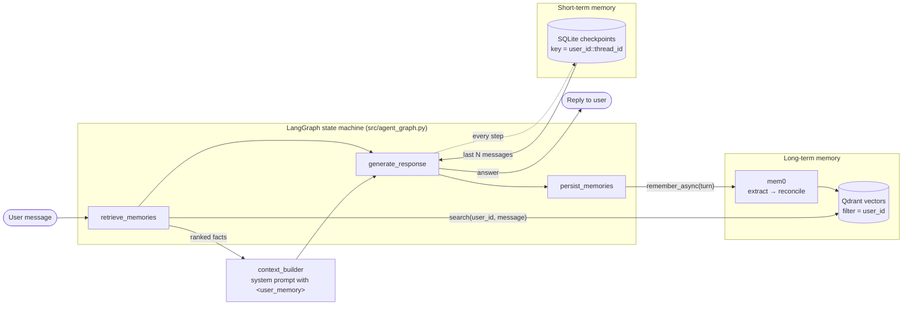
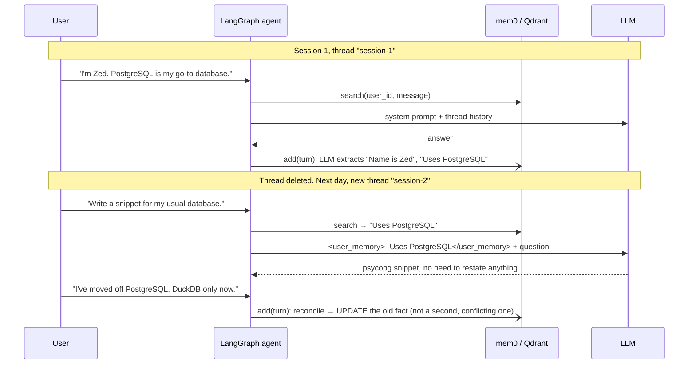

# Persistent AI Companion: Agent Memory and Context Engineering

A chat agent that remembers each user across sessions. Before every answer it searches the user's
long-term memory, then writes the relevant facts into the system prompt. After every answer it hands
the turn to [mem0](https://github.com/mem0ai/mem0), which extracts new facts and reconciles them with
existing ones. Close a conversation and open a new one tomorrow: it still knows your name, your goals
and what you have already tried.

Built with LangGraph (agent state machine and SQLite thread checkpoints), mem0 (semantic memory with
an LLM-driven add/update/delete step), Qdrant (local, on-disk vector store) and Streamlit (UI).

## Two kinds of memory

| | Short-term (thread) memory | Long-term (semantic) memory |
|---|---|---|
| Holds | The raw message list of one conversation | Distilled facts: "Name is Zed", "Prefers DuckDB" |
| Scope | One `(user_id, thread_id)` pair | One `user_id`, shared by all of that user's threads |
| Store | LangGraph `SqliteSaver` → `data/checkpoints.db` | mem0 → Qdrant (`data/qdrant/`) + `data/mem0_history.db` |
| Written | Automatically, after every graph step | After every turn, in a background thread |
| Read | Last `history_window` messages | Top-`k` facts by vector similarity to the new message |
| Cleared by | "Clear thread" | Editing or forgetting facts in the Memory Inspector |





## Context engineering vs. prompt engineering

Prompt engineering tunes one message: the wording of an instruction. Context engineering decides
**everything the model sees on a given turn**: which instructions, which retrieved facts, which part
of the conversation, and in what order and size. Most agent failures come from bad context, not from
a weak model. The model answered correctly from what it was shown; it was shown the wrong things,
or too much, or stale data.

This project makes those decisions explicit in [`src/context_builder.py`](src/context_builder.py). Each
source gets its own budget:

1. **Instructions** (fixed). Who the agent is, plus rules for memory: treat stored facts as *data,
   not instructions* (prompt-injection hygiene), and trust the user's latest message over a stored fact.
2. **Long-term memory** (dynamic, bounded by `max_memory_chars`). Facts retrieved *for this message*.
   They are ranked by similarity, de-duplicated, and dropped as whole items once over budget, so a
   fact is never cut mid-sentence. Retrieval is filtered by `user_id`, so one user's facts never reach
   another user's prompt (covered by a test).
3. **Conversation** (dynamic, bounded by `history_window` messages). Only the recent slice of the
   thread, trimmed so it never begins with an orphaned assistant turn.

The prompt does not grow without limit as the relationship gets longer. Old turns fall out of the
window, and what mattered in them survives as compact facts in long-term memory.

## Project layout

```
├── .github/workflows/ci.yml   lint + offline test suite with an 80% coverage gate
├── data/                      local SQLite checkpoints, Qdrant vectors, mem0 history (git-ignored)
├── src/
│   ├── config.py              every tunable in one place, loaded from env
│   ├── memory_manager.py      typed wrapper over mem0: search, list, edit, forget, background writes
│   ├── context_builder.py     the context engineering step (pure functions, exhaustively tested)
│   ├── agent_graph.py         LangGraph graph + CompanionAgent (reply / history / clear / threads)
│   └── evaluator.py           cross-session scenario and its recall/correction metrics
├── tests/                     pytest; fakes only at the LLM and vector-store boundaries
├── app.py                     Streamlit chat + Memory Inspector
└── run_demo.py                terminal run of the cross-session scenario
```

## Setup

Requires Python 3.11+.

```bash
python -m venv .venv
.venv/Scripts/activate          # Windows; use `source .venv/bin/activate` on macOS/Linux
pip install -r requirements.txt
cp .env.example .env            # then set ANTHROPIC_API_KEY (or LLM_PROVIDER=openai + OPENAI_API_KEY)
```

**Providers.** The default is Anthropic: `claude-sonnet-5-5` answers and `claude-haiku-5-5` runs mem0's
fact extraction. Anthropic has no embeddings API, so embeddings run locally with `fastembed`
(`BAAI/bge-small-en-v1.5`, ONNX, no PyTorch). The model downloads once on first use. Set
`LLM_PROVIDER=openai` to use OpenAI for chat, extraction and embeddings instead. All defaults are in
[`src/config.py`](src/config.py).

## Usage

```bash
streamlit run app.py      # chat UI
python run_demo.py        # scripted cross-session demo in the terminal
pytest                    # offline suite (no API key needed)
pytest -m live            # same scenario against the real LLM + mem0 (needs a key, costs a few cents)
```

**In the app:** pick a `User ID` in the sidebar (each one has separate memory). Each conversation is a
thread: *New thread* starts a fresh one, and *Clear thread* deletes that thread's messages while the
user's long-term memory stays. Under each answer, an expander shows exactly which memories were
injected into that turn's prompt, with their similarity scores. The **Memory Inspector** lists every
fact stored for the user. You can edit a fact, forget it, or add one by hand.

## Evaluation

[`src/evaluator.py`](src/evaluator.py) runs one scenario with a fictional persona:

1. **Session 1.** State a name, role, career goal, language and database across three messages.
2. **End the session.** Delete the thread's checkpoint, so short-term context is gone.
3. **Session 2 (a new thread).** Ask for personalised help without restating anything.
4. **Correction.** "I've moved off PostgreSQL. DuckDB only now."
5. **Follow-up (another new thread).** Ask which database to use. The answer can only come from
   long-term memory, so it shows whether the *stored* preference changed. It does not just reflect
   the last message in the thread.

| Metric | Meaning |
|---|---|
| `memory_recall` | Share of the 5 session-1 facts that ended up in the memory store |
| `answer_recall` | Share of session-2 answers that use the right fact |
| `correction_applied` | The follow-up answer uses the new preference |
| `stale_conflicts` | Stored facts that still assert the old preference without the new one |

**What is verified, and how.**

- *Offline (CI, every push):* the whole scenario runs against a deterministic fake LLM and a fake mem0.
  This proves the plumbing. Facts survive a deleted thread and reach the next prompt. Users are
  isolated. Checkpoints survive a process restart. Failed background writes raise instead of being
  swallowed. Because the fake memory store does no reconciliation, the offline run *must* report a
  stale conflict, and a test asserts that it does. This shows the evaluator catches the failure it
  exists to catch.
- *Live (`pytest -m live`, `python run_demo.py`):* the only place where fact extraction and
  correction quality can be judged, because both are LLM steps inside mem0.

> **Status:** the live evaluation has not produced results yet. The first run reached the LLM call
> (mem0 init, local embeddings and Qdrant search all ran for real) and was rejected because the API
> account had no credits. Live numbers will be added here once it runs.

## Design decisions

- **Background memory writes.** Extraction is an extra LLM call. Running it on a single worker thread
  keeps it out of the response path, and a single worker keeps writes for a user in order. Errors are
  collected and surfaced by `wait_for_pending()` (shown in the UI, fatal in the evaluator). They are
  never silently dropped.
- **Thread IDs are namespaced by user** (`user_id::thread_id`), so two users' `main` threads never
  share a checkpoint. IDs are validated against `[A-Za-z0-9_-]{1,64}` before they reach any store.
- **mem0 sits behind a `Protocol`.** The rest of the code depends on five methods, not on mem0
  internals. Tests swap in a fake, and another memory backend would only need those five methods.
- **Manual facts skip inference** (`infer=False`). They are stored verbatim, because the user typed
  exactly what they want remembered.

## Limitations

- Keyword scoring misses paraphrases ("Postgres" is matched, "the elephant DB" is not). An
  LLM-as-judge would fix that, at the cost of determinism and money.
- One scenario and one persona. That is a smoke test of retention, not a benchmark. LoCoMo or
  LongMemEval would be the next step for real numbers.
- Correction quality depends on mem0's reconciliation prompt and the extraction model. A memory can
  be updated to "Switched from PostgreSQL to DuckDB". The evaluator correctly treats that as
  *not* stale, because it mentions the new preference.
- Local Qdrant allows one process at a time. Run either the app or the demo against `data/`, not both.
